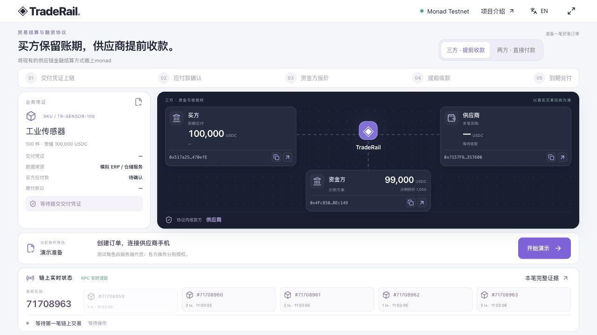
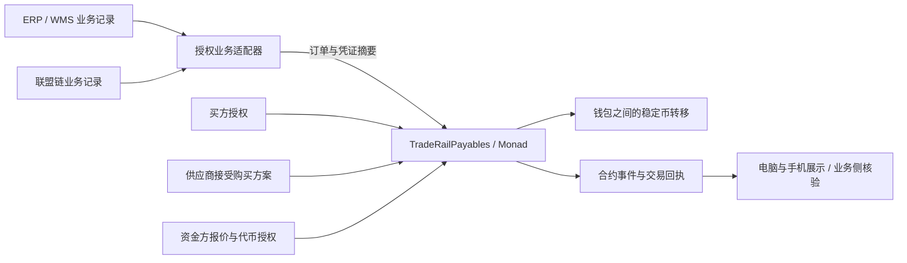

# TradeRail

**Monad 上的贸易结算与融资协议。**

将现有的供应链金融结算方式搬上monad。

TradeRail 连接企业业务记录与公链资金执行：在可信业务事件和各方授权的基础上，用智能合约完成稳定币付款、应收款折价购买和到期结算，让参与方核验同一笔资金结果。

当前版本为 Hackathon 测试网原型：本地电脑承担买方与资金方操作，手机承担供应商操作；仓储记录为模拟数据，资金转移使用真实 Monad Testnet 交易和无美元价值的 MockUSDC。


[项目价值](#项目价值) · [两种业务模式](#两种业务模式) · [Why Monad](#why-monad) · [合约实现](#智能合约实现路径) · [启动](#本地运行) · [演示](#现场演示流程) · [测试](#验证与测试) · [隐私路线](#隐私与商业路线)

## 界面预览



项目介绍页包含业务背景、结算痛点、协议架构、Why Monad、隐私路线和商业落地。内容与页面一起纳入本仓库：

- [项目介绍页组件与英文文案](frontend/components/pitch/deck.tsx)
- [中文介绍文案](frontend/lib/i18n/pitch-zh.json)
- [项目介绍页样式](frontend/components/pitch/pitch.module.css)
- [介绍页入口](frontend/app/pitch/page.tsx)

## 项目价值

### 背景与痛点

在具备数字化能力的仓运体系中，入库、出库、交付和验收事件已经可以进入 ERP、WMS 或联盟链。业务记录可以更新，资金执行与确认却仍可能跨越多个机构和系统。

| 问题 | 对业务的影响 | TradeRail 探索的改进 |
| --- | --- | --- |
| 业务记录与付款指令分离 | 履约完成后，仍需传递、核验并执行付款指令 | 将业务凭证摘要、订单和各方授权关联到结算规则 |
| 到账确认与对账分散 | 各参与方分别确认结果，增加协作环节 | 以链上状态、交易回执和代币转账日志提供共同核验依据 |
| 买方账期与供应商运营需求不同 | 供应商持有应收款，却暂时缺少可用资金 | 支持第三方购买已确认应收款，让供应商选择提前收款 |
| 企业交易需要商业保密 | 公开地址与金额可能暴露客户关系和融资条件 | 将企业隐私结算列为后续接入路线 |

商业账期由各方约定，TradeRail 不会自动取消账期。拟减少的是业务授权、资金执行与结果确认之间的衔接摩擦；真实成本、时间收益和客户需求需要业务试点验证。

### 协议定位与资金来源

TradeRail 提供结算规则与接入能力，**不自行提供贷款资金**。三方模式的资金来自独立资金方，生产合作方可以是经适当安排参与的金融机构或贸易金融资金提供者；当前仅使用预配置的测试账户。

协议探索供应链金融**资金执行层的去中心化**：在各方已持有并同意使用美元稳定币的前提下，将资金动作交给公链合约执行，使结果可共同核验，减少这段资金流转对跨机构指令和确认链路的依赖。法币出入金、外汇兑换、实物核验、信用决策与法律安排仍在业务体系中处理。

## 两种业务模式

两种模式共用业务凭证和应付款确认基础，区别在于是否存在第三方资金以及应收款购买。

| 项目 | 双方贸易付款 | 三方反向保理 |
| --- | --- | --- |
| 经济参与方 | 买方、供应商 | 买方、供应商、资金方 |
| 资金来源 | 买方到期付款 | 资金方提前出资；买方到期付款 |
| 供应商收款 | 付款日收到货款 | 接受报价后提前收到购买价款 |
| 协议内到期收款方 | 供应商 | 应收款购买完成后的资金方 |
| 当前示例 | 买方支付 100,000 MockUSDC 给供应商 | 资金方先支付 99,000；买方到期支付 100,000 给资金方 |

### 双方：直接付款

```text
交付记录提交 → 买方确认应付款与付款日 → 买方到期发起付款 → 供应商收到货款
```

没有资金方报价、应收款转让或融资折价。结算合约根据授权从买方钱包直接向供应商转账，不需要先把货款存入协议资金池。

### 三方：反向保理

```text
交付记录提交 → 买方确认应付款 → 资金方报价
→ 供应商接受报价并提前收款 → 买方到期发起付款 → 资金方收到到期款项
```

示例中，买方确认 60 天后支付 100,000；资金方报价 99,000；供应商接受后提前60天获得运营现金流。1,000 是应收款面值与购买价款的差额，不是另行向供应商收取的还款，也不是年化收益率。

合约的 `holder` 表示**协议内到期收款方**。它不替代线下应收款转让的法律手续，也不保证买方到期偿付。

## Why Monad

Monad 的高性能 EVM 执行为持续发生的贸易付款提供基础。TradeRail 关注这些能力与业务的对应关系，而非用一笔演示交易宣称已验证大规模吞吐。

| 链能力 | 对 TradeRail 的意义 | 当前范围 |
| --- | --- | --- |
| 快速交易确认 | 资金动作确认后，各方可及时核验结果并推进后续业务 | 当前界面等待成功且 finalized 的回执后展示到账 |
| 并行执行 | 为不同企业、独立订单的付款与融资交易并发处理提供基础 | 应用级并发压测尚未完成 |
| EVM 可编程规则 | 在同一笔交易中约束授权、购买价款支付和收款方更新 | 已实现应收款购买的原子执行 |
| 可验证的共享状态 | 钱包地址、合约事件与转账回执可由参与方独立检查 | 当前使用公开测试网记录 |

全球贸易的扩展空间来自持续产生的订单，以及每笔订单中的交付、付款和融资节点。快速确认与可编程执行，未来可支持按约定进行分批交付、分段付款与更细的资金分配；这些并非本版已完成的功能。

并行执行也不意味着所有交易天然互不影响。共享钱包、余额和合约状态可能形成依赖；当前服务还使用会话文件锁串行保护操作。生产扩展需要独立订单状态设计、签名和 nonce 管理、持久化队列及真实负载测试。

参考：[Monad 官方介绍](https://docs.monad.xyz/introduction/why-monad)、[并行执行机制](https://docs.monad.xyz/monad-arch/execution/parallel-execution)。链的性能指标不等于本应用的端到端时延或已测吞吐。

## 架构与信任边界



ERP 和联盟链是可替代的业务记录来源，不必二选一；当前没有实现通用跨链桥或真实企业接口。生产业务源需要通过授权适配器提交信息，而不是由链上合约直接读取任意 ERP 数据。

当前 Demo 中，手机核对商品码，服务端使用 `source` 测试账户提交模拟交付摘要。买方、供应商和资金方使用不同的预配置账户，但签名都由服务端完成；手机不是个人钱包连接器。

需要明确的前提：

- 业务机构负责实物核验与数据准确性；摘要和签名只能证明所提交内容及授权关系。
- 各参与方同意使用美元稳定币结算，并具备余额与合约代币授权。
- 资金方自行承担信用判断与相应风险；协议不提供违约担保。
- 当前 `settle` 必须由买方发起交易，付款日到来不会自动唤醒合约。执行授权、余额不足时，付款不会成功。
- 公链验证资金执行结果，不代表业务输入、签名服务和稳定币发行体系整体去中心化。

## 智能合约实现路径

当前主合约为 [`contracts/TradeRailPayables.sol`](contracts/TradeRailPayables.sol)，测试币为 [`contracts/MockUSDC.sol`](contracts/MockUSDC.sol)。

### 角色与关键数据

部署时固定 `token`、可信业务源 `source`、获准资金方 `capitalProvider` 和测试时钟开关 `demoMode`。每笔 `Invoice` 保存买方、供应商、资金方、协议内收款方、应收面值、购买价格、付款日、报价有效期、凭证摘要和各阶段状态。

订单身份为随机 `bytes32`，与页面的 `PAY-0001` 等展示编号分离；同一订单重试沿用已保存的链上 ID。生成逻辑见 [`backend/lib/order-identity.ts`](backend/lib/order-identity.ts)。

### 合约调用顺序

| 方法 | 授权调用者 | 执行结果与关键检查 |
| --- | --- | --- |
| `recordDelivery(id, doc, buyer, supplier, face)` | 固定业务源 `source` | 创建订单，初始收款方为供应商；拒绝重复订单 ID 和本合约已使用的凭证摘要 |
| `approvePayable(id, dueAt)` | 该订单买方 | 确认应付款及未来付款日；不得重复确认 |
| `offerQuote(id, price, expiry)` | 获准资金方 | 记录购买价格和有效期；要求应付款已确认、价格有效、报价未过付款日 |
| `purchase(id, financier, price)` | 该订单供应商 | 校验报价匹配且有效；从资金方转账给供应商，并把收款方更新为资金方 |
| `settle(id)` | 该订单买方 | 检查到期与未结清状态，从买方转账给当前 `holder` |
| `advanceDemoMaturity(id)` | 开启演示时钟时的订单买方 | 测试环境压缩等待，记录独立事件；保留原始付款日，不修改链时间 |
| `getInvoice(id)` | 公开读取 | 返回该订单的链上状态 |

直接付款路径跳过 `offerQuote` 和 `purchase`。双方／三方模式由应用组织，合约共用收款方及结算规则。

### 原子性与保护范围

`purchase` 在同一笔交易中调用代币 `transferFrom(financier, supplier, price)` 并更新收款方。转账失败则整个交易回滚；不会留下“收款方已变更、价款未支付”的成功状态。`settle` 转账失败同样回滚，订单不会被记为已结清。

购买与结算有重入保护、角色检查和状态约束；合约拒绝重复购买、重复结清及不符合报价的接受操作。凭证去重仅限同一合约部署所见的摘要，不能据此发现其他平台上的重复融资。

测试时钟仅允许在指定测试链／本地链部署时开启；当前部署脚本开启该功能。生产设计须关闭该开关，并重新评估权限、风险控制与审计要求。当前合约没有完成独立安全审计。

### 从业务动作到可信前端结果

1. API 校验本机／供应商会话权限，以及订单当前步骤。
2. 服务端检查链和部署代码，使用对应角色账户模拟合约调用。
3. 签名后先保存交易哈希及原始交易，再广播；不向前端返回私钥、原始签名或会话摘要。
4. 重复请求同一步操作复用已保存交易；未知状态可核查、重播原交易。
5. 查询交易回执与 `finalized` 区块，成功后解析指定 MockUSDC 的 `Transfer` 日志。
6. 前端据确认结果更新到账金额、收款方和动画。实时出块本身不代表该笔付款成功。

相关实现：[`backend/settlement-v4/service.ts`](backend/settlement-v4/service.ts)、[`frontend/components/payables-demo.tsx`](frontend/components/payables-demo.tsx)。

## 本地运行

### 运行条件

| 依赖 | 用途 |
| --- | --- |
| Node.js 22 或更高版本、npm | 安装工作区依赖、构建与运行 Next.js |
| 可访问的 Monad Testnet RPC | 读取区块、广播交易与核验回执 |
| 配置匹配的测试角色私钥与测试网 MON | 执行各方演示交易 |
| Foundry 的 `forge` | 重新部署合约或运行 Solidity 测试时需要 |
| `cloudflared`、可联网手机 | 实体手机跨设备 HTTPS 演示时需要 |

**本地运行指应用运行在本机，当前 V4 连接 Monad Testnet（Chain ID `10143`），并非纯离线运行。**历史本地 EVM／V3 脚本不等于当前 V4 的启动路径。

### 1. 安装依赖与配置环境

首次下载：

```sh
git clone https://github.com/jamese5095/traderail.git
cd traderail
npm ci
```

已经下载源码时，在项目根目录执行 `npm ci` 即可。

首次配置时，把 `.env.example` 复制为 `.env`，填入专用测试角色。已有配置不要覆盖。实际部署角色的私钥不包含在交付包中。

| 变量 | 当前用途 |
| --- | --- |
| `GUIDED_DEMO_ENABLED=true` | 显式启用受限的测试角色代签 |
| `WAREHOUSE_PRIVATE_KEY` | 业务源提交交付摘要 |
| `BUYER_PRIVATE_KEY` | 确认应付款、推进测试付款日、到期支付 |
| `SUPPLIER_PRIVATE_KEY` | 接受应收款购买方案 |
| `LENDER_PRIVATE_KEY` | 资金方报价、部署时准备代币授权 |
| `DEPLOYER_PRIVATE_KEY` | 重新部署及测试资产准备 |
| `RPC_URL` | V4 部署脚本的可选 RPC 覆盖 |
| `TRADERAIL_RPC_URL` | V4 运行时的可选 RPC 覆盖 |
| `DEMO_SESSION_DIR` | 可选的订单会话持久化目录 |

`npm start` 会读取根 `.env` 和可选 `frontend/.env.local`；后者由开发者自行创建，不提供对应示例文件。运行时环境变量优先，避免同一角色在多处配置不同值。不要使用 `NEXT_PUBLIC_*` 保存私钥。

使用已有部署时，四个业务签名角色必须匹配 `frontend/lib/payables-deployment.json`。复制项目并不会获得这些账户的签名能力；需要使用自己的角色时，应重新部署。

### 2. 需要时，部署自己的 V4 测试环境

先在 `.env` 配置部署者及四个不同角色的测试私钥，并准备 gas。部署者需要部署和准备交易的 MON；业务源、供应商也需要各自后续交易使用的 MON。脚本会按需从部署者补充买方／资金方 gas，不会替所有角色自动申请测试币。

```sh
npm run deploy:v4:monad
```

脚本编译合约，部署独立 MockUSDC 与协议，为买方和资金方铸造测试币并设置有上限的代币授权，然后更新：

- `deployments/traderail-v4-monadTestnet.json`
- `frontend/lib/payables-deployment.json`
- `frontend/lib/payables-abi.json`

部署会发送真实测试网交易并生成准备记录。它不部署官方 USDC，不提供真实美元资金。变更部署配置后，重新构建并启动应用。

### 3. 构建和启动

```sh
npm run build
npm start
```

| 入口 | 地址 |
| --- | --- |
| 电脑 Demo | [http://localhost:3000/](http://localhost:3000/) |
| 七页双语项目介绍 | [http://localhost:3000/pitch](http://localhost:3000/pitch) |
| 供应商页面 | `/supplier`，须通过本轮配对进入 |
| 可打印货物标签 | [http://localhost:3000/goods](http://localhost:3000/goods) |
| 当前 V4 链上证据 | Demo 主屏的「本笔完整证据」 |

`/evidence` 和 `/operations` 等旧页面仍关联历史版本；核验当前订单请使用 V4 主屏入口。

### 4. 启动手机入口

另开终端：

```sh
npm run phone
```

脚本创建供应商专用网关与临时 HTTPS 隧道，输出手机入口。桌面生成的配对码自动读取当前入口。手机先用系统相机扫**配对码**进入供应商端，再在供应商页面扫**货物码**。

网关仅转发供应商页面、必要静态资源和供应商 API，不开放桌面签名入口。配对码一次性使用、10 分钟有效，供应商会话最长 4 小时；新一轮重新配对。临时域名随进程变化，上台前检查实体手机可达性。

### 部署范围

当前支持受控 Node.js 主机运行；`npm start` 默认绑定本机地址，桌面代签 API 要求本机来源。仅把整个服务暴露到公网，不会获得安全的多租户产品。面向真实机构部署前，需要独立身份认证、机构签名／托管方案、数据持久化和权限设计。手机演示使用上述受限网关。

## 现场演示流程

建议完整演示一笔三方反向保理，双方付款作为基础能力说明。

| 步骤 | 设备与角色 | 操作 |
| --- | --- | --- |
| 准备 | 电脑 | 选择「三方 · 提前收款」→「开始演示」→「连接供应商手机」 |
| 配对 | 手机 | 系统相机扫描本轮配对码 |
| 交付 | 手机／供应商入口 | 扫货物码→核对→「确认并提交交付凭证」；实际由授权业务源账户签名 |
| 确认 | 电脑／买方 | 「确认应付款」 |
| 报价 | 电脑／资金方 | 「发布提前收款方案」 |
| 购买 | 手机／供应商 | 阅读条款、勾选接受→「接受方案并提前收款」 |
| 测试到期 | 电脑／买方 | 「演示推进至付款日」 |
| 支付 | 电脑／买方 | 「支付到期款项」 |
| 核验 | 电脑 | 查看钱包地址、资金动画、区块及「本笔完整证据」 |

每笔交易确认后再进行下一步。相机不可用时，在页面备用输入 `TR-SENSOR-100` 并核对，不能把备用输入说成实际扫描。

双方模式选择「两方 · 直接付款」，跳过报价与购买，最后由供应商收到全部货款。金额和地址来自当前部署；两种模式共用同一组测试角色，新建订单不更换钱包。

**重复演示：**本轮结清后选下一轮模式，点击「新开双方付款演示」或「新开三方融资演示」。尚未提交链上交易的草稿可切换模式；提交后锁定。回放按钮只重播已确认转账的视觉效果，不发新交易。

详细操作见 [DEMO-V4.md](DEMO-V4.md)，五分钟逐字稿和时间控制见 [ROADSHOW-5MIN-ZH.md](ROADSHOW-5MIN-ZH.md)。

## 部署与独立核验

以下为随代码提供的默认配置；重新部署后以 `frontend/lib/payables-deployment.json` 为准。

| 项目 | 当前默认配置 |
| --- | --- |
| 网络 | Monad Testnet / `10143` |
| 结算合约 | [`0xa932a00d497d0270b1186a97a911dc05a8c37d7a`](https://testnet.monadscan.com/address/0xa932a00d497d0270b1186a97a911dc05a8c37d7a) |
| MockUSDC | [`0x751e9670cbd7071f66ea654b34410deac24da898`](https://testnet.monadscan.com/address/0x751e9670cbd7071f66ea654b34410deac24da898) |

主屏角色卡片显示地址缩写，支持复制完整地址与打开区块浏览器；证据弹窗列出本轮交易哈希、区块、Gas 和转账记录。可在浏览器检查代币合约、发送方、接收方、数量及交易成功状态，并用 `getInvoice` 对照收款方与结清状态。

订单会话存于本机 `.demo-sessions`，其中包含权限与重试所需的敏感运行状态，不能作为公开交付物。源码包不附带订单历史、运行会话或测试私钥。清理本地文件不会删除公链历史；重新演示使用新订单 ID，不伪造旧交易时间。日期说明见 [DATE-NORMALIZATION.md](DATE-NORMALIZATION.md)。

## 验证与测试

先安装 npm 依赖。以下检查不需要发送链上交易：

```sh
npm run typecheck
npm run build
node --experimental-strip-types --test scripts/order-identity.test.ts
```

当前 V4 合约测试（需要 Foundry）：

```sh
cd contracts
forge test --match-contract TradeRailPayablesTest -vv
```

覆盖双方付款、反向保理、调用者权限、凭证去重、重复购买／结清、报价过期与篡改、提前结算限制、转账失败回滚及测试时钟约束。`npm run test:contracts` 运行包含旧版本在内的全部合约测试。

`npm run test:presentation` 是保留的 V3 展示状态测试，不应将其通过视为当前 V4 UI 的完整验收。

需要真实测试网联调时，先启动服务、配置角色与余额，并确保无未完成订单，再运行：

```sh
npm run test:v4
```

该脚本会依次执行三方和双方流程，检查角色隔离、一次性配对、商品码、重复请求、转账及历史保留，并写入 `deployments/traderail-v4-rehearsal.json`。**它会发送真实测试网交易、消耗测试 gas 并产生订单记录**，不是只读验收。实体手机相机、隧道和现场网络仍需实际彩排。

## 隐私与商业路线

### 当前已实现

- 双方直接付款与三方应收款折价购买的测试网闭环。
- 电脑与供应商手机分工、商品码核对和一次性配对。
- 角色钱包、已确认资金动画、真实区块与交易证据展示。
- 双语项目介绍、业务背景、Why Monad 和商业路线。
- 本轮保留、下一轮新建及交易重试身份复用。

### 下一阶段

1. **真实业务与资金方接入：**对接第三方仓储、ERP／联盟链授权接口；明确应付款确认、应收款权利、信用判断与违约处置。
2. **机构操作与可靠性：**各方独立管理签名权限，增加持久化任务、状态恢复、监控和多机构并发测试。
3. **更细的结算节点：**评估分批交付、部分付款和部分应收款购买；本版只处理整笔金额。
4. **隐私结算：**计划评估 Category Labs / Monad Private Settlement 方向，探索交易关系和融资条款的保密处理、按权限披露及审计访问；当前代码未集成该能力。

商业服务面向供应链平台、企业财务与资金机构，探索企业接入订阅和按笔结算服务费。当前没有真实客户、资金机构合作或收入验证的声明。应通过小范围业务试点检验需求、定价和实际节省。

## 技术栈与目录

Next.js 16、React 19、TypeScript、Viem、Solidity 0.8.28、Foundry；二维码由 `qrcode` 与 ZXing 支持，跨设备入口使用 Cloudflare Tunnel。

```text
frontend/
  app/                    页面及 Next.js API 路由
  components/             主 Demo、双语项目介绍与样式
  lib/payables-*          V4 类型、ABI、公开部署配置
  public/images/          项目介绍素材
backend/
  settlement-v4/service.ts 当前订单、授权、签名与回执处理
  lib/order-identity.ts    随机链上订单身份
contracts/
  TradeRailPayables.sol    当前结算与应收款购买协议
  MockUSDC.sol            无美元价值的可铸造测试币
  test/                   Solidity 测试
scripts/                  启动、手机网关、部署及测试
deployments/              公开部署配置
```

`backend/settlement-v3`、旧合约和旧页面为保留版本；当前主页 `/` 使用 V4。不要混用不同版本的 API、ABI 或部署脚本。

当前主要接口：

| 接口 | 用途与权限 |
| --- | --- |
| `GET /api/payables` | 本机电脑读取订单、历史和公开部署信息 |
| `POST /api/payables` | 本机创建、草稿切换模式、执行对应步骤 |
| `POST /api/payables/pair` | 本机生成本轮一次性配对码 |
| `POST /api/field/pair` | 手机兑换配对码，获得 HttpOnly 供应商会话 |
| `GET /api/field` | 已配对手机读取当前订单 |
| `POST /api/field` | 供应商入口提交交付／接受报价，不开放买方与资金方操作 |
| `GET /api/blocks` | 读取真实网络区块；RPC 失败返回不可用状态 |

## 常见问题

| 情况 | 检查方式 |
| --- | --- |
| 测试签名未启用 | 检查 `GUIDED_DEMO_ENABLED`、当前测试网配置和 `demoOnly` |
| Signer mismatch | 私钥对应地址需与部署角色匹配；更换角色应重新部署并构建 |
| 手机扫配对码后打不开 | 检查 `npm run phone`、隧道网络、当前入口及是否重新生成配对码 |
| 供应商提示重新配对 | 会话过期、配对码已使用或进入新一轮，回电脑重新配对 |
| 链上预检失败 | 检查步骤、角色 gas、MockUSDC 余额、代币授权及报价有效期 |
| 已广播但界面未到账 | 等待回执与最终确认；核查原交易，不以出块或动画推断成功 |
| 无法切换双方／三方 | 已提交交易的订单模式锁定，结清后为下一轮选择模式 |

## 文档与素材

- [演示操作与业务边界](DEMO-V4.md)
- [七页项目介绍说明](PRESENTATION-V4.md)
- [五分钟路演逐字稿与操作提示](ROADSHOW-5MIN-ZH.md)
- [图片来源与使用说明](ASSETS.md)
- [本地日期字段说明](DATE-NORMALIZATION.md)

合约文件包含各自的 SPDX 标识；仓库尚未附统一项目许可证。第三方素材按来源条款处理，图片不代表实际合作机构或客户。当前为未审计测试原型，不接收或承诺管理真实客户资金。
